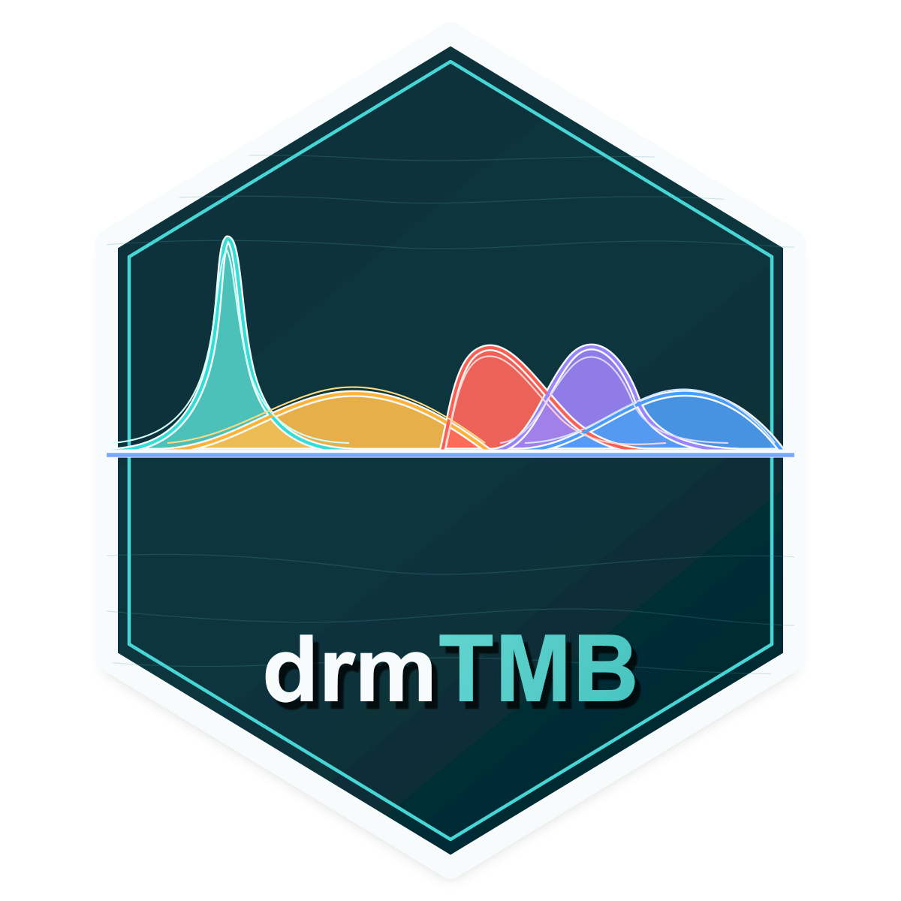

# drmTMB <a href="https://itchyshin.github.io/drmTMB/"></a>

<!-- badges: start -->
[](https://github.com/itchyshin/drmTMB/actions/workflows/R-CMD-check.yaml)
[](https://github.com/itchyshin/drmTMB/actions/workflows/pkgdown.yaml)
[](https://lifecycle.r-lib.org/articles/stages.html#experimental)
<!-- badges: end -->

## Model more than the average

`drmTMB` is an R package that fits **distributional regression models (DRMs)**
for one or two responses. Distributional regression lets predictors change
not only an outcome's average, but also other features of its distribution:
for example, how variable it is or how likely it is to be zero.

Use it for questions such as: does temperature change average growth; is growth
less predictable in one habitat; or, after accounting for their averages and
variability, do two responses still vary together? The worked examples come
from ecology, evolution, and environmental science.

`drmTMB` 0.7.1 is the development version; 0.7.0 is on CRAN. The package is
experimental: start with a documented example, check the fitted model, and
read [Can I fit and report this model?](https://itchyshin.github.io/drmTMB/articles/capability-and-limits.html)
before reporting a result.

## A first model

A Gaussian **location-scale** model gives the response two formulas: one for
its location `mu` (here, the expected response) and one for its scale `sigma`
(here, the residual standard deviation, SD):

```text
y_i ~ Normal(mu_i, sigma_i^2)
mu_i         = beta_0  + beta_1  x1_i
log(sigma_i) = gamma_0 + gamma_1 x1_i
```

`i` indexes observations, the `beta` coefficients belong to the `mu` formula
`y ~ x1`, and the `gamma` coefficients belong to the `sigma` formula
`sigma ~ x1`. The simulation below sets `beta = (0.2, 0.4)` and
`gamma = (-0.4, 0.5)`:

```r
library(drmTMB)

set.seed(1)
dat <- data.frame(x1 = rnorm(80))
dat$y <- rnorm(
  80,
  mean = 0.2 + 0.4 * dat$x1,
  sd = exp(-0.4 + 0.5 * dat$x1)
)

fit <- drmTMB(
  drm_formula(y ~ x1, sigma ~ x1),
  family = gaussian(),
  data = dat
)

check_drm(fit)
#> <drm_check: 15 checks>
#> ok: 15; notes: 0; warnings: 0; errors: 0
#> ... (one row per check, omitted here)

summary(fit)
#> <summary.drmTMB>
#> estimator: ML
#>                     estimate  std_error
#> mu:(Intercept)     0.1177344 0.07444611
#> mu:x1              0.2770564 0.06319075
#> sigma:(Intercept) -0.5073711 0.07947806
#> sigma:x1           0.5241616 0.07697847
#> ... (fitted-sigma range, logLik, and convergence code omitted here)
```

`check_drm()` checks optimizer convergence, gradients, the Hessian, standard
errors, dropped rows, and fitted scales. A clean fit reports zero notes,
warnings, and errors, as above; resolve any warning or error before reading
estimates. In `summary(fit)`, `mu:` rows are the `beta` coefficients on the
response scale and `sigma:` rows are the `gamma` coefficients on the log-SD
scale. Each estimate here is within about two standard errors of the simulated
value (80 observations). A positive `sigma:x1` means residual variation
increases with `x1`; exponentiate it to report an SD ratio:

```r
sigma_x1 <- coef(fit, "sigma")["x1"]
exp(sigma_x1)      # residual SD ratio per one-unit increase in x1: 1.69
exp(2 * sigma_x1)  # residual variance ratio: 2.85
head(sigma(fit))   # fitted residual SD for each observation
```

The [getting-started article](https://itchyshin.github.io/drmTMB/articles/drmTMB.html)
walks through a larger example and the full `summary()` output.

## Parameter names

Each distributional parameter has one formula name and one plain-English name,
used throughout the documentation:

| Formula name | Name in the guides | What it describes |
| --- | --- | --- |
| `mu` (`mu1`, `mu2`) | location | Where the response distribution sits; for a Gaussian response, the expected response. |
| `sigma` (`sigma1`, `sigma2`) | scale | Spread around `mu`; for a Gaussian response, the residual SD, modelled on the log scale. |
| `nu` and other family-specific names | shape | Features beyond location and scale, such as Student-t tail weight. |
| `zi`, `hu` | zero inflation, hurdle | The probability of an extra zero, or of a zero from a separate hurdle process. |
| `rho12` | residual correlation (coscale) | How two responses vary together within an observation after their `mu` and `sigma` models. |

## If you already use lme4 or glmmTMB

The `mu` formula is an ordinary `lme4`/`glmmTMB` formula, random-effect terms
such as `(1 | site)` included. Each further parameter gets its own named
formula; for a Gaussian model, the `sigma` formula plays the role of
`glmmTMB`'s `dispformula`:

```r
glmmTMB::glmmTMB(y ~ x + (1 | site), dispformula = ~ x, data = dat)
drmTMB(bf(y ~ x + (1 | site), sigma ~ x), family = gaussian(), data = dat)
```

`bf()` is a short alias for `drm_formula()`; its name and layout follow
`brms::bf()`. [Comparing drmTMB with other packages](https://itchyshin.github.io/drmTMB/articles/comparing-with-other-packages.html)
fits the same models side by side in `drmTMB` and in `lm()`, `lme4`,
`glmmTMB`, `metafor`, and other packages.

## Install

Install the released version from CRAN:

```r
install.packages("drmTMB")
```

To try development changes before a release, install from GitHub with `pak`:

```r
install.packages("pak")
pak::pak("itchyshin/drmTMB")
```

You need R 4.1.0 or newer and a working compiler toolchain because TMB models
are compiled during installation. If installation fails while compiling C++,
install the usual R build tools for your platform: Rtools on Windows, Xcode
Command Line Tools on macOS, or the R development toolchain on Linux.

The installer also installs the packages `drmTMB` imports (`cli`, `lifecycle`,
`Matrix`, `nlme`, and `TMB`, plus base R's `methods`, `stats`, and `utils`)
and the compile-time headers from `RcppEigen` and `TMB`. The articles also use
suggested packages, including `glmmTMB`, `lme4`, `MASS`, `metafor`, `knitr`,
and `rmarkdown`; the `Suggests` field of `DESCRIPTION` lists them all.

The GitHub install does not build the vignettes, so `vignette("drmTMB")`
reports that the vignette is not found. Read the articles on the
[package website](https://itchyshin.github.io/drmTMB/), install the CRAN
release, or build them locally with
`remotes::install_github("itchyshin/drmTMB", build_vignettes = TRUE)`, which
also needs the suggested packages.

## Start with your scientific question

Choose one route. Each begins with a runnable example and tells you what to
check before interpreting the result.

| If your data and question are... | Start here | Important limit |
| --- | --- | --- |
| One response, and predictors may change its average or residual variability | [Distributional regression with drmTMB](https://itchyshin.github.io/drmTMB/articles/drmTMB.html) | Begin with the simplest response family that matches the data, and run `check_drm()` after every fit. |
| A trait measured across related species, with a tree | [Phylogenetic mixed models](https://itchyshin.github.io/drmTMB/articles/phylogenetic-models.html) | The first worked route is Gaussian. It needs repeated observations within species to separate phylogenetic from residual variation. |
| One Gaussian response measured at named sites with coordinates | [Coordinate-spatial structured effects](https://itchyshin.github.io/drmTMB/articles/spatial-models.html) | Start with a spatial `mu` intercept. Repeated observations within sites are needed to separate spatial from residual variation; this route does not establish range estimates or intervals. |
| Effect sizes with known sampling variances or covariance | [Mean effects and residual heterogeneity](https://itchyshin.github.io/drmTMB/articles/meta-analysis.html) | This is Gaussian regression with `meta_V(V = V)`, not a response family for raw observations. |

For a count, proportion, zero-heavy, robust, bivariate, pedigree, or
known-matrix analysis, use [What can I fit today?](https://itchyshin.github.io/drmTMB/articles/model-map.html)
to find the relevant guide.

## What can I fit today?

The table summarises what is fitted in 0.7.1. The
[model map](https://itchyshin.github.io/drmTMB/articles/model-map.html) gives
the exact forms and the guide for each row, and
[Can I fit and report this model?](https://itchyshin.github.io/drmTMB/articles/capability-and-limits.html)
says which estimates and intervals are ready to report.

| Model | Fitted now | Not yet supported |
| --- | --- | --- |
| One response, fixed effects | One formula per family parameter for Gaussian, Student-t, skew-normal, lognormal, Gamma, Tweedie, beta, zero-one beta, beta-binomial, binomial, Poisson, NB2, zero-inflated Poisson and NB2, truncated NB2, hurdle NB2, and cumulative-logit ordinal responses | Ordinal scale models, ordered beta, predictor-dependent Tweedie power |
| Gaussian random effects | `mu` and `sigma` random intercepts, independent slopes, and correlated intercept-slope blocks | Covariance between `mu` and `sigma` slopes across formulas |
| Non-Gaussian random effects | `mu` random intercepts and independent numeric slopes for Student-t, skew-normal, lognormal, Gamma, Tweedie, beta, zero-one beta, beta-binomial, binomial, Poisson, NB2, truncated NB2, and cumulative-logit responses | Correlated non-Gaussian slopes |
| Random-effect SD models | `sd(group) ~ x_group` for Gaussian `mu` random intercepts | Slope-specific `sd()` formulas |
| Meta-analysis | Gaussian `meta_V(V = V)` with diagonal, dense, or bivariate known sampling covariance | Non-Gaussian or sparse known covariance |
| Two responses | Bivariate Gaussian `mu1`, `mu2`, `sigma1`, `sigma2`, and predictor-dependent `rho12`; matching random intercepts across the two responses | Random effects in `rho12`, mixed-family pairs |
| Phylogenetic, spatial, pedigree, and known-matrix effects | Gaussian `mu` and `sigma` intercepts and one numeric `mu` slope; Poisson and NB2 `mu` intercept plus one slope | Multiple or labelled structured slopes, structured `rho12`, simultaneous phylogenetic and spatial terms |
| Missing predictors | One missing predictor `mi(x)`, modelled inside the same likelihood | A general missing-data framework |
| Large data | Memory-light fits, `se = FALSE`, sparse `mu` design matrices, Gaussian aggregation | Speed claims for random-effect, structured, non-Gaussian, or bivariate models |

## Current boundaries

`drmTMB` fits one-response and two-response models only.

A model that fits is not proof that its uncertainty is reliable. Do not assume
that a family example extends to multiple random effects, a new structured
effect, missing data, or a different interval method. Check
[Can I fit and report this model?](https://itchyshin.github.io/drmTMB/articles/capability-and-limits.html)
for those cases, and inspect `check_drm()` and the interval output before
reporting a complex model.

The residual correlation `rho12` describes how two responses vary together
within an observation. It is different from a correlation among groups,
species, or locations, which `drmTMB` reports as separate covariance
summaries. Use the [model map](https://itchyshin.github.io/drmTMB/articles/model-map.html)
when your question involves more than one kind of correlation.

### Maximum likelihood and REML

`drmTMB` fits by maximum likelihood (ML) unless you set `REML = TRUE`. Use ML
to compare models with different fixed effects. Restricted maximum likelihood
(REML), the `lme4::lmer()` default, is for estimating variance components in
the documented Gaussian models, after the fixed effects are chosen.
[Model selection with AIC and BIC](https://itchyshin.github.io/drmTMB/articles/model-selection.html)
shows both steps.

## Engines

`drmTMB` uses **Template Model Builder (TMB)** to fit models by default.
`DRModels.jl` is an optional Julia companion. For supported models, the
[Julia engine guide](https://itchyshin.github.io/drmTMB/articles/julia-engine.html)
shows how to select it from R with `engine = "julia"` and explains its limits.
Julia is not required to install or use the default R workflow.

## Project status

The package is under active development. See
[Can I fit and report this model?](https://itchyshin.github.io/drmTMB/articles/capability-and-limits.html), the
[reference index](https://itchyshin.github.io/drmTMB/reference/index.html), and
the articles above for the current fitted workflows.
